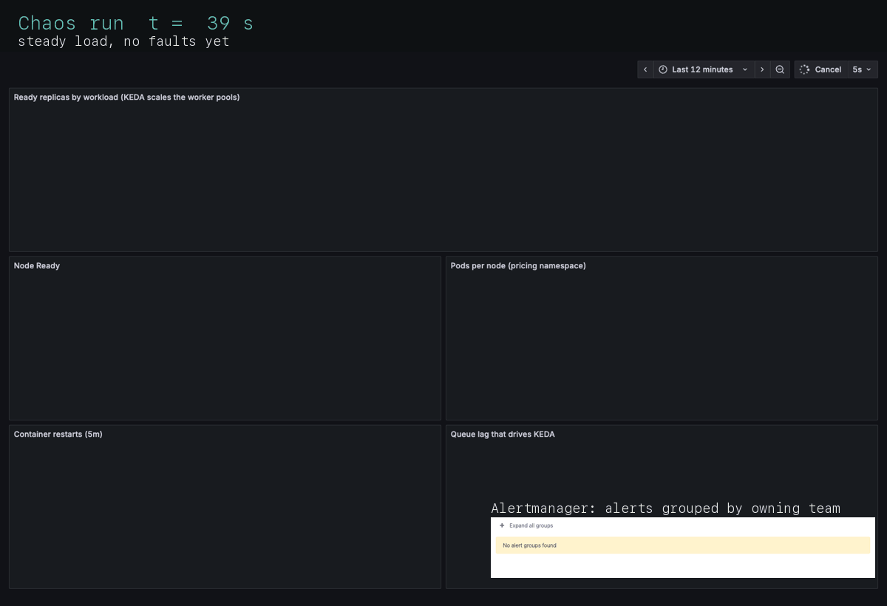
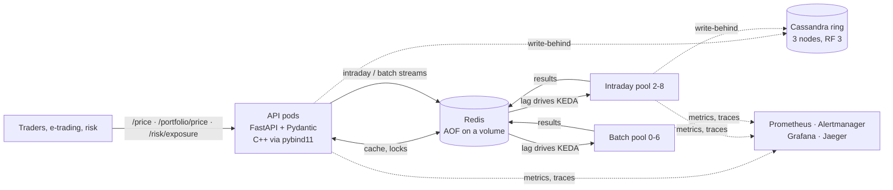
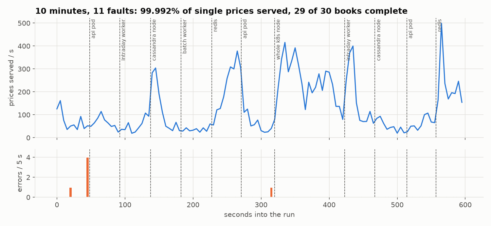
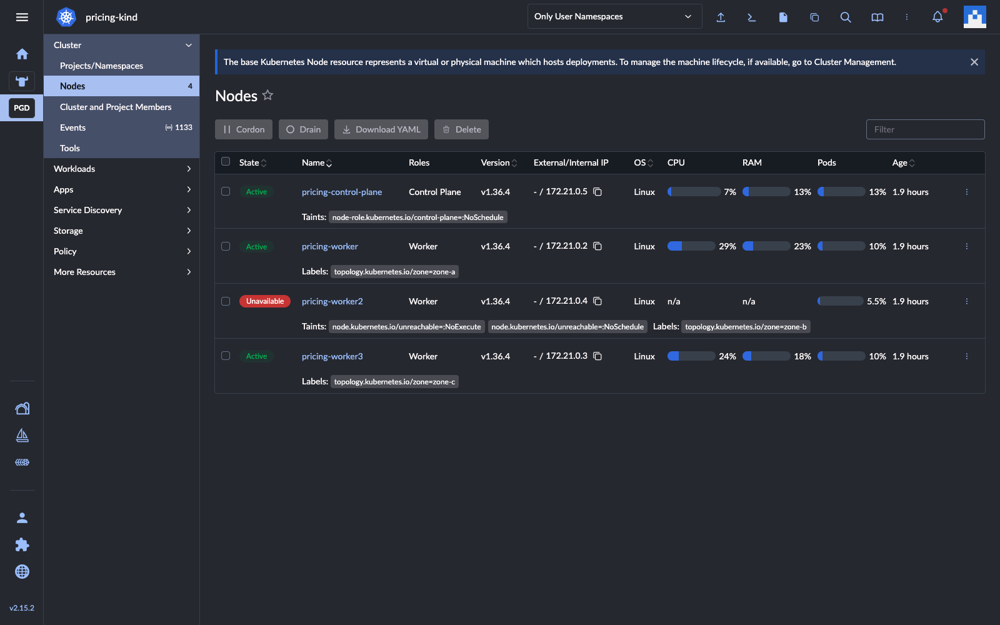
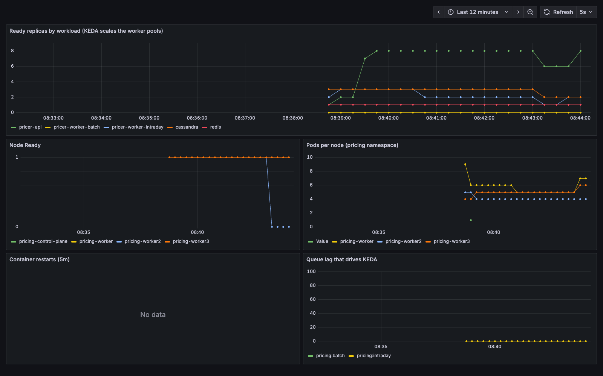
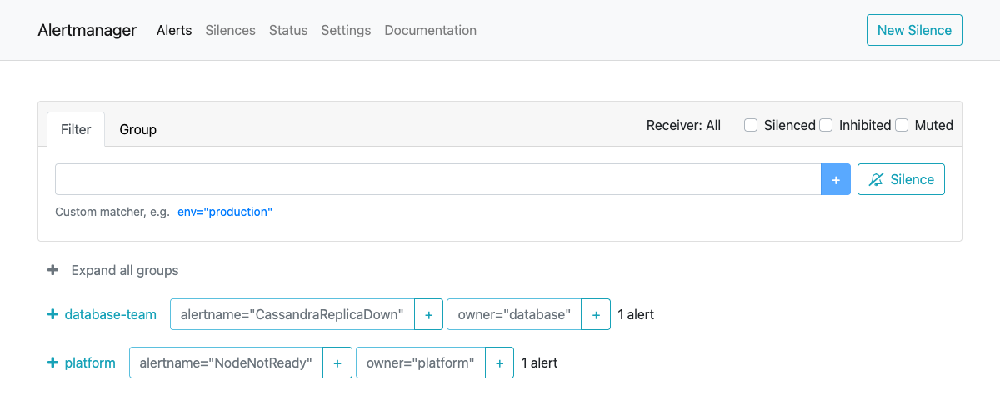
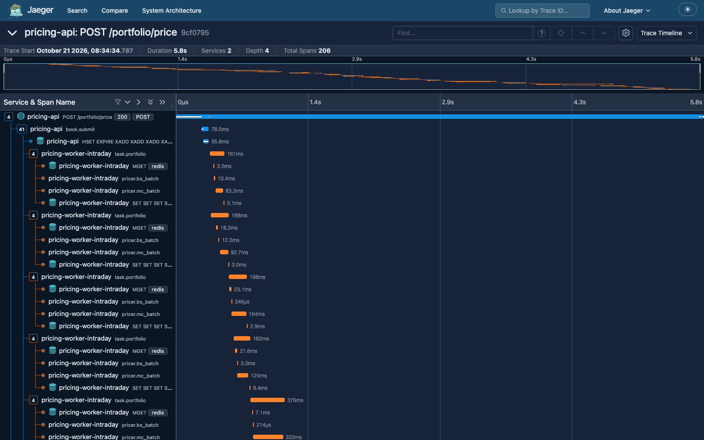
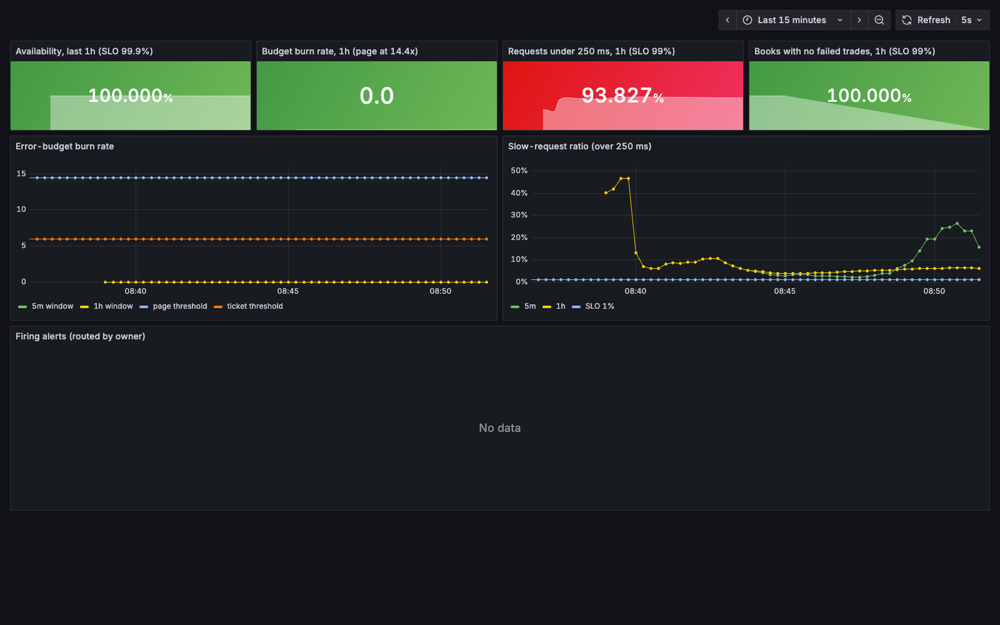
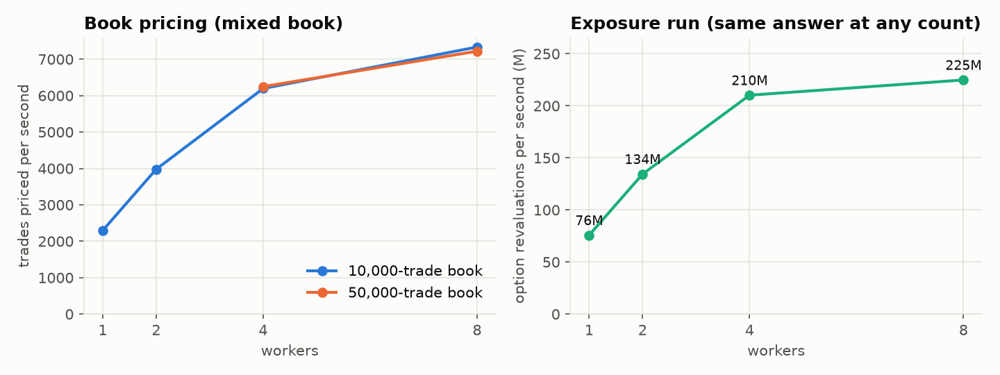
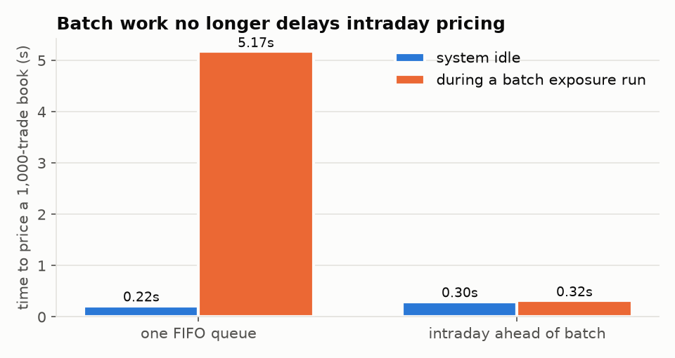

# Distributed Pricing Service

[](https://github.com/SukhmanAulakh18/distributed-pricing-service/actions/workflows/ci.yml)

A front-office analytics platform in miniature, built and operated the way a
core engineering team runs one. A **C++20 pricing and exposure library** is
exposed to Python with **pybind11**, behind a **FastAPI** service with
**Pydantic** contracts. Books and risk runs are spread across
**Kubernetes** worker pools autoscaled by **KEDA** on **Redis Streams** lag,
with a 3-node **Cassandra** ring (RF 3) keeping the price log. The cluster is
managed in **Rancher**, traced with **OpenTelemetry** and **Jaeger**, and
watched by **Prometheus**, **Alertmanager** and **Grafana** against written
SLOs. Chaos tests then kill its pods, its databases and a whole node.

**[Read the report →](https://sukhmanaulakh18.github.io/distributed-pricing-service/)** (one page; every number on it is generated from `bench/results`)



> An independent learning project on synthetic data and textbook models. It is
> not affiliated with or derived from any employer's system. Every number here
> was measured on my laptop by the scripts in `bench/`.

## At a glance

| | Result |
| --- | --- |
| **Chaos, 10 minutes, 11 faults** | API pods, workers, a Cassandra node and Redis SIGKILLed, and one Kubernetes node stopped for 2 minutes: **99.992%** of 76,481 single prices served; **29 of 30 books** complete with **0 failed trades** out of 58,000; 4 of 4 exposure runs **bit-identical** |
| **Alerts routed to owners** | During the chaos run: `NodeNotReady` and `RedisCircuitOpen` → platform, `CassandraReplicaDown` → database, `PodRestarting` → core engineering |
| **One book, one trace** | A 2,000-trade book is one Jaeger trace across the API and 2 worker pods (206 spans). Tracing every request costs about 11%, so prod samples 5% |
| **Autoscaling on queue lag** | KEDA scales the batch pool 0 → 6 on stream lag; a cold start costs 10 s to the first worker (38 s run vs 9 s warm) |
| **Intraday protected from batch** | An intraday book during a big exposure run: **5.17 s → 0.32 s** after splitting intraday and batch streams |
| **Book pricing** | 50,000-trade book in **6.9 s** on 8 workers; 2,295 → 7,335 trades/s from 1 to 8 workers |
| **Exposure and CVA** | 604 million option revaluations in **2.7 s**; PFE and CVA identical on 1, 2, 4 and 8 workers |
| **pybind11 and the GIL** | 8 Python threads: **175 pricings/s** with the GIL released vs 46 with it held; **147M** Black-Scholes prices/s through one zero-copy NumPy call |
| **Memory and threads** | ASan + UBSan, ThreadSanitizer and Valgrind clean, including Valgrind on the Python extension |
| **Tests** | 35 C++ (GoogleTest) and 74 Python (pytest). CI checks the manifests (kubeconform), alert rules (promtool) and Alertmanager routing (amtool) |

## How this maps to the role

The target is an analyst role in a core engineering team that supports a
distributed analytics library for front-office pricing.

| The job | Where it is in this repo |
| --- | --- |
| Support a distributed analytics library for front-office and intraday pricing | `core/` (C++ library) behind `/price`, `/portfolio/price` (intraday books on one worker pool) and `/risk/exposure` (batch exposure and CVA on another) |
| Triage issues intraday and route them to the right team | Every alert carries an `owner` label that Alertmanager routes on. `tools/triage.py` names the owner and runbook section, and [RUNBOOK.md](RUNBOOK.md) has an ownership table and 14 real incidents |
| Liaise with support teams on the environment | Kustomize base plus kind and prod overlays, Rancher managing the cluster, and SLOs and dashboards as code that every team reads the same way |
| Review the architecture, propose performance improvements | [docs/PERFORMANCE_REVIEW.md](docs/PERFORMANCE_REVIEW.md): 14 findings, each measured before and after, three of my own hypotheses disproved |
| Kubernetes, Docker, Rancher | 4-node kind cluster across 3 zones, imported into Rancher. PDBs, topology spread, 30 s eviction from a lost node, KEDA and HPA |
| Redis and Cassandra | Redis: cache, stampede lock, priority Streams with consumer groups and reclaim, AOF. Cassandra: query-first tables, RF 3, `LOCAL_QUORUM`, token-aware routing, write-behind. See [docs/ARCHITECTURE.md](docs/ARCHITECTURE.md) |
| Python and C++ | Python service and tools, and a C++20 core with pybind11. See [docs/ENGINEERING.md](docs/ENGINEERING.md) |

## Architecture



Prices are deterministic. The seed comes from the request's hash, and the
RNG is counter-based, so path *i* gets the same numbers on any thread,
worker or node. That one property makes caching safe, makes any split
across workers exact, and makes re-running a dead worker's task harmless.
It is why the exposure runs in the chaos test came back bit-identical.

The cluster has 1 control plane and 3 workers labelled into 3 zones. API
pods and workers spread across zones, and Cassandra's 3 replicas sit on 3
different nodes. The observability stack runs on the control plane so it
survives the loss of a worker node. Once, it did not: see RUNBOOK
incident 11.

## Reliability: chaos testing

`make chaos` runs 10 minutes of mixed load while `bench/chaos.py` works
through a fault schedule.



| What happened | Why the service held |
| --- | --- |
| API pod SIGKILLed (×3) | Readiness takes it out of the Service; the other pods carry the load |
| Intraday or batch worker SIGKILLed | Its unacked tasks are reclaimed with `XAUTOCLAIM`, and results are written before the ack |
| Cassandra node SIGKILLed (×2) | RF 3 with `LOCAL_QUORUM` writes; the token-aware driver routes around it |
| Redis SIGKILLed (×2) | A circuit breaker keeps pricing going uncached, and queued work survives on the AOF |
| A whole Kubernetes node stopped for 120 s | Stateless pods are evicted after 30 s and rescheduled; Cassandra serves at quorum |

What the chaos runs found, and what is still open, is in the performance
review (findings 11 and 14):

- **Run 1** lost 3 books in the window before Kubernetes noticed the dead
  node. Fixed with an idempotent retry.
- **Run 2** showed the node alert could never fire, because the monitoring
  lived on that node. The monitoring has been moved to the control plane.
- **Run 3** still lost 1 book in 30 to connection resets during the
  outage. Still open: the proposed fix is an idempotency key the client
  can poll on.

## Observability

**One node down, seen three ways.** A worker node was stopped under load.
Rancher shows it Unavailable and tainted, Grafana shows its Ready line
drop, and Alertmanager routes each alert to its owner:

| Rancher | Grafana |
| --- | --- |
|  |  |



**A book as a trace.** The trace context travels inside each Redis Stream
message, so one book is one trace. It runs from the API, through the
queue, into each worker's Redis calls and C++ batches:



**SLOs, not thresholds.** The targets are 99.9% availability and 99% of
prices under 250 ms, alerted on multi-window burn rate. See
[docs/SLO.md](docs/SLO.md), including why the latency SLO is the one this
laptop struggles with.



## Distribution and performance





Book throughput is near-linear to 4 workers, then the laptop runs out of
cores. Separate intraday and batch streams and pools let an intraday book
finish in 0.32 s while a large exposure run is queued. The rest (task
size, CPU throttling, the price log's cost) is in the
[performance review](docs/PERFORMANCE_REVIEW.md).

## Engineering highlights

- **C++ core**: a counter-based Philox RNG (checked against known-answer
  vectors), deterministic chunked parallelism and exception-safe threads.
  There is no heap allocation per path (a test counts `operator new`), and
  scratch memory is cache-line aligned to avoid false sharing.
- **pybind11**: the GIL is released around every heavy call. NumPy goes in
  and out without copies; variable-size results reach NumPy through a
  capsule that owns the C++ buffer. C++ exceptions become `ValueError`.
- **Memory checks** in a Linux tools image: ASan + UBSan, TSan, Valgrind on
  the C++ tests, and Valgrind on the Python extension. Leaks are attributed
  to our module, and zero growth is required from 2 to 20 rounds of calls.
- **Service**: Pydantic discriminated unions with work caps (a runaway
  request is a 422, not an OOM-killed pod), admission control sized to the
  pod's CPU limit (503 + `Retry-After`), circuit breakers and write-behind.
- **Models**: European and arithmetic Asian options by Monte Carlo
  (antithetic variates, pathwise Greeks, and a geometric control variate
  that cuts variance 1,009×). An exposure engine computes EE, PFE and CVA
  on correlated GBM. The models are textbook on purpose; see
  [docs/MODELS.md](docs/MODELS.md).

## Documentation

| Read | For |
| --- | --- |
| [System design](docs/SYSTEM_DESIGN.md) | Sequence diagrams for each request path, the determinism argument, and the decisions with their costs |
| [Operations](docs/OPERATIONS.md) | Cluster topology, placement and disruption rules, Rancher, node-loss timeline, alerts, dashboards, tracing, on-call flow |
| [SLOs](docs/SLO.md) | Objectives, burn-rate alerting, what the chaos runs showed |
| [Runbook](RUNBOOK.md) | Ownership table, symptom-to-action sections, 14 past incidents |
| [Performance review](docs/PERFORMANCE_REVIEW.md) | 14 findings, each measured before and after |
| [Architecture](docs/ARCHITECTURE.md) · [Engineering](docs/ENGINEERING.md) · [Models](docs/MODELS.md) · [Code audit](docs/CODE_AUDIT.md) | Component detail, C++ and pybind11, the maths, bugs found in review |

## Run it

Requirements: Docker (12 GB of memory for the full cluster with Rancher),
`kind`, `kubectl`, Python 3.10+, a C++20 compiler and CMake.

```bash
make install     # Python deps + build the C++ extension (scikit-build-core)
make test        # 35 C++ + 74 Python tests
make cpp-checks  # ASan/UBSan, TSan, Valgrind in the Linux tools image
make cluster     # 4-node kind cluster, KEDA, the app, Prometheus, Alertmanager, Grafana, Jaeger
make rancher     # Rancher in Docker, with the kind cluster imported
make demo        # guided walkthrough: prices, a 10,000-trade book, an exposure run, a failure, triage
make chaos       # the 10-minute chaos run
make triage      # triage the running cluster
```

On the kind cluster:

| Service | Address |
| --- | --- |
| API | `localhost:8080` |
| Grafana | `localhost:3001` |
| Prometheus | `localhost:9091` |
| Alertmanager | `localhost:9093` |
| Jaeger | `localhost:16686` |
| Rancher | `https://localhost:8443` |

`make up` runs a lighter Docker Compose stack instead.

```bash
curl -s -X POST localhost:8080/price -H 'Content-Type: application/json' -d '{
  "instrument_id": "SYN-1", "market_data_version": "md-2026-10-21",
  "product": {"type": "asian", "spot": 100, "strike": 100, "rate": 0.03, "vol": 0.25,
              "maturity": 1, "n_fixings": 12},
  "simulation": {"n_paths": 200000, "greeks": true}}'
```

To tear it all down:

```bash
kind delete cluster --name pricing && docker rm -f rancher
```

## Repository layout

```text
core/          C++ library (include/mc, src), pybind11 bindings, GoogleTest suite
service/       FastAPI app, worker, Pydantic models, Redis cache and queue, Cassandra store, tracing
tools/         triage CLI
tests/         pytest: API, books, exposure, bindings, models, tracing, triage
bench/         benchmarks, chaos and failure tests, chart generation
deploy/        Kustomize base + kind/prod overlays, observability stack, kind config, Compose
scripts/       memory checks, Rancher setup, demo, report and screenshot tooling
docs/          site (index.html), system design, operations, architecture, SLOs, performance review, audit
```

## Limitations

- One laptop: every node is a container sharing the same 10 vCPUs. Scaling
  numbers show the mechanics, not cluster capacity, and the latency SLO
  suffers when Rancher and the cluster compete for CPU.
- Textbook models: GBM, constant volatility, flat curves. The exposure run
  has no collateral, margin period of risk or wrong-way risk.
- Redis is a single instance (persistent, but not replicated). The prod
  overlay is validated but has not run on a production cluster.
- No authentication or rate limiting.

## License

MIT. See `LICENSE`.

## Contact

Sukhmanpreet Singh Aulakh · Oakville, ON · [GitHub](https://github.com/SukhmanAulakh18)
