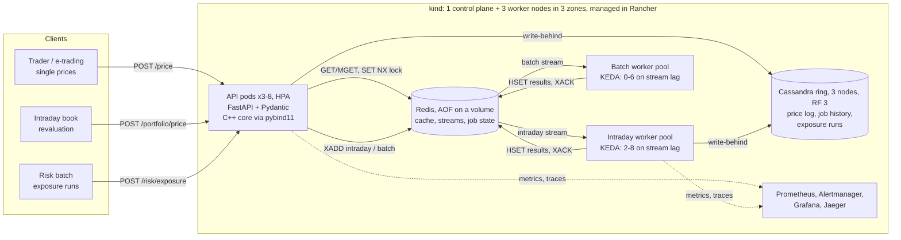

# Architecture

A small version of what a front-office analytics platform team runs: a
numerical library that quants own, wrapped as a service that traders,
e-trading and risk call, distributed over a worker pool, with a cache, a
store, and a deployment that is triaged and tuned in production.

## Components

| Component | Owns | Why this tool |
| --- | --- | --- |
| C++ core (`core/`) | Monte Carlo and closed-form pricing, exposure simulation | The hot loop: no GIL, no allocations, exact reproducibility |
| API (`service/main.py`) | Validation, single prices, job submission and gathering | Typed boundary (Pydantic), async-friendly server, Prometheus metrics |
| Workers (`service/worker.py`) | Book slices (intraday pool) and exposure blocks (batch pool) | Horizontal scale for throughput, isolated from the API's latency, each pool sized by KEDA on its own queue |
| Redis | Cache, task streams, job state | Microsecond reads; Streams give consumer groups, acks and reclaim for free |
| Cassandra | Price log, job history, exposure runs | Write-heavy, time-partitioned data read by known keys; a replicated ring survives a node loss |
| KEDA | Worker pool sizes | Scales on queue lag (a leading signal) instead of CPU (a lagging one), and scales batch to zero |
| Prometheus, Alertmanager, Grafana, Jaeger | Metrics, SLO alerts routed by owner, dashboards, distributed traces | See [SLO.md](SLO.md) |
| Rancher | Fleet view and management of the cluster | Nodes, workloads, events and logs in one UI; how a platform team runs many clusters |

## Three request paths

**Single price (synchronous, latency matters).** `POST /price` → validate →
hash → Redis `GET`. On a hit, done (about 1 ms). On a miss: take a `SET NX`
lock so only one pod computes a given request, price in C++ with the GIL
released, cache with a TTL, and hand the log row to the write-behind queue.
Closed-form Europeans (`method: analytic`) take microseconds and skip
simulation altogether.

**Book (distributed, intraday priority).** `POST /portfolio/price` splits
the book into tasks of `task_size` trades and enqueues them in one
pipelined round trip on the intraday stream. Each worker validates its
slice, does one `MGET` for the whole slice, prices analytic trades in one
vectorised C++ call and Monte Carlo trades one by one, writes back with one
pipelined `SET`, pre-aggregates (PV, variance per contract, delta and vega by
underlying), and returns a small summary. The API waits, gathers and merges.

**Exposure run (distributed, batch priority, asynchronous).**
`POST /risk/exposure` returns `202` with a job id. The netting set is stored
once in Redis and each task references a block of scenarios, rather than
copying the portfolio into every message. Workers return per-step sums and
each step's largest exposures as raw float64 bytes. `GET /risk/exposure/{id}`
merges the blocks the first time all are present and stores the result.

## Determinism: the property everything else leans on

Monte Carlo is random, but this system is not:

- The seed is derived from the SHA-256 of the canonical request, and the
  RNG is counter-based (Philox): path *i* always gets the same numbers, on
  any thread, worker, OS or compiler.
- So **caching is safe** (a repeat request gets the identical answer),
  **any split is exact** (a book or exposure run priced across 8 workers is
  bit-identical to one worker), and **reclaiming a dead worker's task is
  harmless** (the recomputed result overwrites the same field with the same
  value).
- It also makes the price log reproducible: any logged price can be
  recomputed from its request hash.

Quantiles do not merge the way sums do, so PFE uses an exact trick: each
block keeps its top *k* exposures per step, with *k* = n − ⌈qn⌉ + 1. The
global top *k* is always inside the union of the blocks' top *k*, so the
merged PFE equals the single-run PFE to the last bit (tested in C++ and
Python).

## Redis, used for what it is good at

| Use | Mechanism | Detail |
| --- | --- | --- |
| Price cache | `GET` / `MGET`, `SET EX` (pipelined) | Key = hash of product, simulation and market-data version, so a new version never serves an old price. 30 s TTL. |
| Stampede lock | `SET NX PX` + compare-and-delete Lua | One pod computes a hot miss; the others wait for the cache. A dead lock holder costs one recompute, not a hang. |
| Work queue | Streams + consumer groups | At-least-once delivery, explicit `XACK`, pending list, `XAUTOCLAIM` of tasks idle more than 10 s, poison after 3 deliveries. |
| Durability | AOF, `appendfsync everysec`, on a persistent volume | Queued tasks and job state survive a Redis restart; at most about a second of writes lost. `volatile-ttl` eviction drops 30 s cache keys long before job state, and never streams |
| Priority | Two streams, intraday read first | Batch never queues ahead of intraday (measured: 5.17 s → 0.32 s for a 1,000-trade book, performance review finding 4). |
| Job state | Hashes with TTL | Results keyed by task index; large numeric arrays stored as binary, not JSON. |
| Circuit breaker | In the client | After 3 failures, Redis is skipped for 5 s instead of every request waiting out a timeout. |

## Cassandra, modelled query-first

One table per question, partitioned so partitions stay bounded:

| Table | Partition key | Answers | Notes |
| --- | --- | --- | --- |
| `prices_by_day` | `(trade_date, instrument_id)` | "What did we price for X today?" | `request_hash` in the clustering key so same-millisecond writes do not overwrite; 30-day TTL |
| `job_runs` | `(day)` | "What ran today and what failed?" | The triage tool's first query; `LOCAL_QUORUM`, because triage acts on it |
| `exposure_runs` | `(netting_set_id)` | "Latest exposure profile for this netting set" | Clustered by `run_at DESC` |

The ring has **3 nodes with replication factor 3** (`NetworkTopologyStrategy`),
one per Kubernetes node (required anti-affinity), with a PodDisruptionBudget
of one. Job history and exposure runs use `LOCAL_QUORUM` (2 of 3), so any
one node can fail with no failed write and no stale read. The driver is
token-aware, so each statement goes straight to a replica that owns its
partition.

Writes are prepared, idempotent upserts (`is_idempotent = True`, so the
driver may retry), sent concurrently with up to 64 in flight. They are not
sent as a multi-partition `BATCH`, which would funnel every row through one
coordinator. Schema changes are additive and idempotent (`MIGRATIONS`),
because old and new pods run side by side during a rolling update.

## Failure behaviour

| Failure | What clients see | Mechanism | Measured |
| --- | --- | --- | --- |
| API pod crash | A handful of errors for under a second | Readiness drops it; kube-proxy routes around it | 0.02% errors over 0.34 s (1 of 3 pods) |
| Worker crash mid-book | Book completes, slower | Unacked tasks reclaimed via `XAUTOCLAIM` | 0 of 10,000 trades lost |
| Worker SIGTERM (deploy) | Nothing | Finishes its current task, then exits | +0.5 s |
| Redis down | Uncached prices, books priced on API pods | Circuit breaker, local fallback | 0 errors |
| Cassandra down | Nothing; price log has a gap | Write-behind, circuit breaker, readiness not gated | 0 errors |
| Poison trade | That trade fails; the rest of the book prices | Delivery count > 3 → failed, acked | Tested |
| Malformed queue message | Nothing | Logged, acked and dropped instead of crashing workers | Tested |
| Request too big | `422` | Work caps in the Pydantic models | Tested |
| Whole Kubernetes node lost | A few connection errors until the node is declared NotReady (~50 s) | Stateless pods evicted after 30 s and rescheduled; Cassandra serves at quorum | Chaos runs: 99.999% of single prices served |
| Cassandra node crash | Nothing | RF 3, `LOCAL_QUORUM` | Chaos runs |
| Redis restart | Books wait it out | AOF keeps the queue; book waits retry Redis errors | Chaos runs |
| Cassandra unreachable at pod start | Nothing; pods start and price | Background connection (`ConnectingStore`) | Tested |
| API saturated | `503 Retry-After: 1` | Admission semaphore sized to the CPU limit | Tested |

## Deployment and environments

- **Cluster**: kind with a control plane and three worker nodes labelled
  `zone-a/b/c`, pinned to Kubernetes 1.36 (what Rancher 2.15 supports).
  Stateless pods spread across zones (`topologySpreadConstraints`) and leave
  an unreachable node after 30 s instead of the default 5 minutes.
- **Kustomize** `base/` (app, 3-node Cassandra, persistent Redis, two worker
  pools, KEDA ScaledObjects), `deploy/observability` (Prometheus with pod
  discovery and SLO rules, Alertmanager, Grafana, Jaeger,
  kube-state-metrics), `overlays/kind` (both, NodePorts on localhost) and
  `overlays/prod` (registry image, bigger pools and ranges, 5% trace
  sampling; rendered, schema-checked and server-side dry-run, not run on a
  production cluster).
- **Config** lives in one `configMapGenerator` ConfigMap. Its name carries a
  content hash, so changing a value rolls every Deployment that uses it.
- **Probes**: liveness means the process is alive; readiness means this pod
  can price, and is deliberately not gated on shared dependencies (see
  RUNBOOK, incident 2).
- **Rolling updates** with `maxUnavailable: 0`, a `preStop` sleep so
  endpoints drain before the server stops, a PodDisruptionBudget, and HPAs
  on CPU.
- **Rancher** (`make rancher`): a local Rancher 2.15 imports the kind cluster
  through its API, so nodes, workloads, events and pod logs can be viewed and
  managed there. The manifests are plain Kubernetes plus Kustomize, which is
  also what Rancher Fleet deploys for GitOps (Fleet itself not set up here).

## Observability and triage

- **Distributed tracing** (OpenTelemetry, OTLP to Jaeger): a book's trace
  starts at the API, travels in each Redis Stream message as a W3C
  `traceparent`, and continues in every worker that prices part of it,
  including its Redis and Cassandra calls. One 2,000-trade book is one trace
  across the API pod and every worker pod. Idle polling and price-log writes
  are deliberately left out of traces.
- JSON logs carry `request_id` and `trace_id` on every line; every response
  carries `x-request-id`, `x-trace-id` and `x-served-by`.
- Prometheus metrics: request and cache outcomes, latency histograms, C++
  compute time by product, queue backlog per stream, worker tasks by kind and
  outcome, circuit-breaker state, admission rejections, price-log drops.
- **SLOs** with multi-window burn-rate alerts, and component alerts that each
  carry an `owner`. Alertmanager routes them to that team, with inhibition so
  one root cause pages once ([SLO.md](SLO.md)).
- Three Grafana dashboards as code: the service, its SLOs, and the cluster
  (replicas per workload, node readiness, KEDA activity).
- `tools/triage.py` turns all of the above, plus today's job history and pod
  state, into findings, each with an owner and a runbook section.
