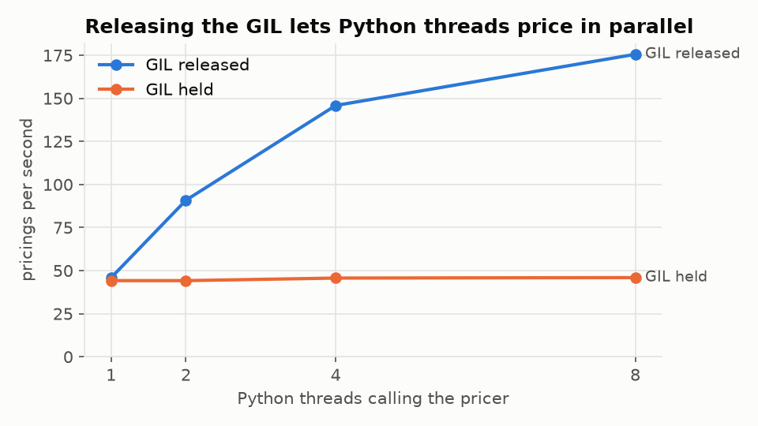
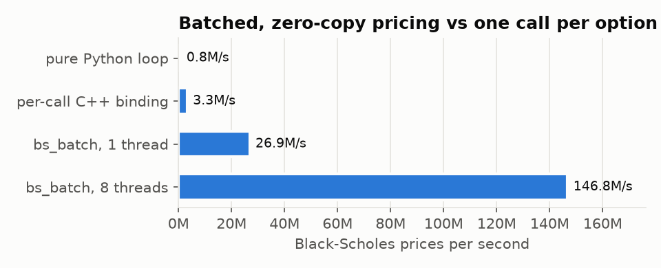

# Engineering notes: C++, pybind11, the GIL, memory and testing

## The C++ core (`core/`)

C++20, about 800 lines plus 200 of bindings, built two ways from one `CMakeLists.txt`: as the
`pricer_core` Python module (scikit-build-core drives CMake for
`pip install .`) and as a GoogleTest binary, optionally with sanitizers.

### Reproducible randomness

`random.hpp` implements **Philox4x32-10**, a counter-based generator: the
output is a pure function of (counter, key). Path *i* uses counter
`(i, block, stream)` and key = seed, so:

- results do not depend on thread count or chunking (tested bit-for-bit
  for 1, 2, 3, 8 and 16 threads);
- every worker draws the same numbers for scenario *i*, which makes
  distributed runs exact;
- the stream is the same on macOS (libc++) and Linux (libstdc++). The first
  version used `std::normal_distribution`, which differs between the two
  standard libraries (the same request priced 7.145307 on macOS and
  7.145384 in the container).

The implementation is checked against Random123's published known-answer
vectors. Normals come from Acklam's inverse-CDF approximation (relative
error below 1.15e-9) evaluated on min(p, 1 − p), so `inv(1 − u) == −inv(u)`
exactly and antithetic pairs are exact negations.

### Deterministic parallelism without a thread pool

`parallel_for` splits work into fixed-size chunks (8,192 samples). Threads
claim chunks from an atomic counter, each chunk accumulates into its own
`Moments`, and the chunks are merged in chunk order. Floating-point addition
is not associative, so a fixed summation order is what makes the result
bit-identical for any thread count.

Two details:

- **Exceptions.** An exception escaping a `std::thread` calls
  `std::terminate`, which would kill the Python process. Each task runs in
  `try`/`catch`, the first exception is stored, remaining tasks are skipped,
  and it is rethrown on the calling thread after every thread has joined.
  If thread creation itself fails (container PID limits), the threads that
  did start are joined before rethrowing.
- **Why not a persistent pool.** Spawning threads per call costs tens of
  microseconds against pricings of milliseconds. A pool would add shutdown,
  fork-safety and lifetime complexity for no measurable gain.

### Memory

- **RAII everywhere.** The only manual allocation is `AlignedBuffer`, a
  move-only owner of 64-byte-aligned memory. Copying is deleted, moves leave
  the source empty, self-move is safe, and the size is overflow-checked.
- **No false sharing.** Each thread's scratch slice is padded to whole
  cache lines (`cache_line_stride`), so two cores never write to the same
  64-byte line in the hot loop.
- **No allocation per path.** One scratch slab and one chunk table per
  call. `test_memory.cpp` replaces global `operator new` to count
  allocations and asserts that pricing 100,000 and 1,000,000 paths makes the
  same number of allocations.
- **Bounded memory per request.** The exposure tail buffer is capped in C++
  (`kMaxTailElements`) and in the request model (`MAX_TAIL_BYTES`), so no
  request can exceed a pod's memory limit.

## pybind11 and the GIL

| Pattern | Where | Why |
| --- | --- | --- |
| `py::call_guard<py::gil_scoped_release>()` | `price_european_mc`, `price_asian_mc` | Arguments are converted while the GIL is held, then released for the whole C++ call |
| Manual `py::gil_scoped_release` scope | `bs_batch`, `simulate_exposure` | Validate shapes and take buffer pointers with the GIL held, compute without it, reacquire to build the return value |
| Zero-copy NumPy in | `py::array_t<double, c_style \| forcecast>` | Reads the caller's buffer directly; copies only if the dtype or layout is wrong |
| Zero-copy NumPy out, preallocated | `bs_batch` | Output arrays are allocated as NumPy arrays and C++ writes into them |
| Zero-copy NumPy out, capsule-owned | `simulate_exposure` | Result size is known only after computing. A `std::vector`'s buffer is handed to NumPy with a `py::capsule` that deletes it when the array dies. A `unique_ptr` covers the window before the capsule exists, so a throw there cannot leak. |
| Exceptions | `std::invalid_argument` → `ValueError` | pybind11 translation; tests check the messages |
| `py::mod_gil_not_used()` | module | No global mutable state, so the module is declared safe for free-threaded CPython (3.13t+) |

What releasing the GIL buys, measured with N Python threads each calling the
pricer (`bench/bench_core.py`):

And what a batch interface buys over a call per option:

## Testing

| Layer | Tool | Count | What it proves |
| --- | --- | --- | --- |
| C++ unit | GoogleTest | 35 | Philox known-answer vectors, inverse-normal accuracy, Black-Scholes vs textbook and finite differences, MC vs closed forms within 4 SE, thread-count invariance, the exact block merge, exception propagation, allocation-free hot loop, RAII buffer semantics |
| Python bindings | pytest | 5 | Batch vs scalar, capsule-owned arrays outlive the call, `ValueError` mapping, identical results across concurrent callers |
| Service | pytest + fakeredis | 69 | Validation (422s), cache behaviour, degraded modes, admission control, distributed == local, priority order, reclaim and poison, malformed messages, write-behind, background Cassandra connection, trace propagation through the queue, dedicated worker pools, triage rules |
| Integration | Docker Compose | benches | Every benchmark asserts zero failed trades |
| Failure | kind + `failure_test.sh` | 4 scenarios | SIGKILL API pods, Redis and Cassandra under load |

Statistical tests assert against standard errors, never fixed tolerances, so
they remain valid at the 10× smaller path counts used under Valgrind
(`MC_TEST_FAST=1`).

## Memory and thread checks

`scripts/cpp_checks.sh` runs in a Debian 13 tools image (GCC 14, Valgrind
3.24), locally (`make cpp-checks`) and in CI:

| Check | Result |
| --- | --- |
| AddressSanitizer + UBSan | 34 tests pass, 1 skipped by design (it replaces `operator new`, which ASan owns) |
| ThreadSanitizer | 35/35, no data races |
| Valgrind memcheck, C++ tests | 0 errors; all 1,203 heap blocks freed |
| Valgrind memcheck, Python extension | 0 invalid reads, writes or uninitialised uses; 181 bytes lost via `pricer_core` after 2 rounds of calls **and** after 20 (one-time registration of the module's functions at import), so nothing leaks per call |

The extension check deserves a note. Valgrind reports about 426 KB
"definitely lost" for any Python process, including a bare `import numpy`,
because CPython does not free some objects it creates at import. The script
therefore counts only leak records whose allocation stack passes through
`pricer_core`, and fails if that number grows with the number of calls.

### Toolchain problems found on the way

| Problem | Cause | Fix |
| --- | --- | --- |
| ASan test binary hung at 100% CPU before `main` | Apple clang 17's ASan runtime loops in dyld's shared-cache iteration on this macOS release | Run sanitizers on Linux (tools image, CI) |
| Valgrind aborted inside NumPy | Valgrind 3.19 cannot parse newer DWARF in the NumPy wheel | Debian 13 image with Valgrind 3.24 |
| TSan: `personality()` failed | Docker's default seccomp profile blocks it | `--security-opt seccomp=unconfined` for that check |
| Sanitizer build "failed" | `gtest_discover_tests` runs the binary at build time | `DISCOVERY_MODE PRE_TEST` |
| ASan alloc-dealloc mismatch | The allocation-counting test replaces `operator new`, which ASan also owns | Compile the replacement out under ASan; the test runs in the other builds |
