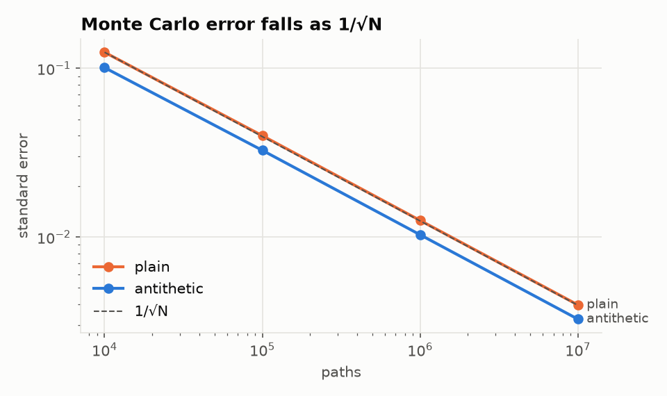
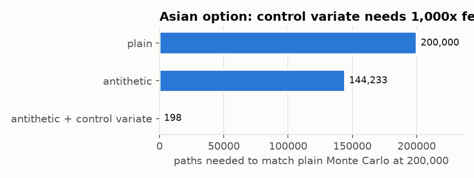
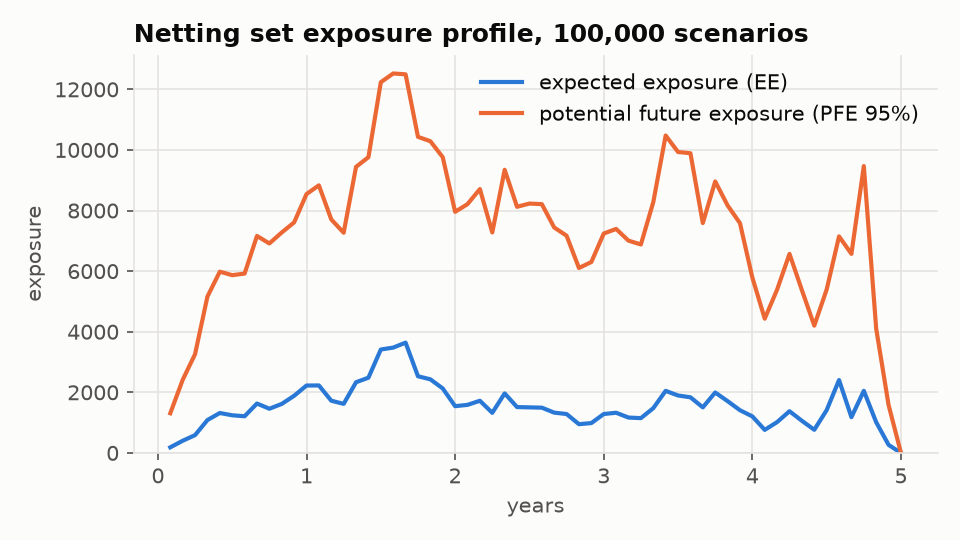

# Models and how they are validated

Deliberately standard, textbook models: the point of the project is the
platform around them. Each one is checked against an independent reference
in a named test.

## Products

| Product | Model | Method | Reference used to validate | Test |
| --- | --- | --- | --- | --- |
| European call/put | Black-Scholes-Merton (GBM, continuous dividend yield) | Closed form | Hull's textbook value (10.4506); put-call parity; finite-difference Greeks | `BlackScholes.*` |
| European call/put | GBM | Monte Carlo, antithetic, pathwise delta and vega | Closed form within 4 standard errors | `EuropeanMc.PriceAndPathwiseGreeksMatchBlackScholes` |
| Arithmetic Asian | GBM, n equally spaced fixings | Monte Carlo + geometric-Asian control variate | Plain MC agrees within combined error; one fixing reduces exactly to Black-Scholes | `AsianMc.*` |
| Geometric Asian | GBM | Closed form | Brute-force simulation written out in the test | `GeometricAsian.MatchesBruteForceSimulation` |
| Exposure (EE, PFE) | Correlated GBM, full revaluation per step | Monte Carlo | Long call: EE(t) = C(0)e^{rt} (martingale); forward: closed-form Black formula | `Exposure.*` |
| Negative exposure (ENE, for DVA) | Same scenarios | Monte Carlo | Short call: ENE(t) = C(0)e^{rt} | `Exposure.ShortCallNegativeExposureIsForwardValue` |
| Collateralized exposure (CSA) | Two-way thresholds, MTA, independent amount, margin period of risk | Monte Carlo, same scenarios | A scenario-by-scenario reference written out in the test; unreachable thresholds give the uncollateralized result bit for bit; zero thresholds with no MPoR leave zero exposure | `Csa.*` |

## Monte Carlo

Under GBM the terminal price is

$$S_T = S_0 \exp\left(\left(r - q - \tfrac{1}{2}\sigma^2\right)T + \sigma\sqrt{T}\,Z\right)$$

and the price is the discounted mean payoff, with standard error
$\hat\sigma/\sqrt{N}$.

**Antithetic variates.** Each draw $Z$ is paired with $-Z$. The standard
error is computed over pair averages, because the two halves of a pair are
negatively correlated, not independent.

**Pathwise Greeks.** Delta $= e^{-rT} E[\mathbf 1_{ITM} S_T/S_0]$ and vega
$= e^{-rT} E[\mathbf 1_{ITM} S_T(\sqrt{T}Z - \sigma T)]$ (with the payoff's
sign), estimated from the same paths as the price. This is unbiased because
the payoff's kink has probability zero. For products without pathwise
Greeks, the service can bump and revalue (`simulation.greeks`): the
counter-based RNG reuses the same random numbers for each bump (common random
numbers), so the differences are smooth.

**Control variate (Asian).** The geometric average of lognormals is
lognormal, so the geometric Asian has a closed form. With $X$ the arithmetic
payoff and $Y$ the geometric one:

$$\hat\theta = \bar X - \beta(\bar Y - E[Y]),\qquad \beta = \frac{\mathrm{Cov}(X,Y)}{\mathrm{Var}(Y)},\qquad \mathrm{Var}(\hat\theta) = \frac{\mathrm{Var}(X)(1-\rho^2)}{n}$$

with $\log G \sim N\!\left(\log S_0 + (r-q-\tfrac{\sigma^2}{2})\tfrac{T(n+1)}{2n},\ \sigma^2 T\tfrac{(n+1)(2n+1)}{6n^2}\right)$.
The two payoffs are about 99.95% correlated, so the variance falls about
1,000×:

## Exposure, PFE and CVA

For a netting set of options and forwards on correlated underlyings
(Cholesky factor of the correlation matrix), each scenario evolves every
underlying on a monthly grid. At each step every live trade is revalued
(Black-Scholes for options, closed form for forwards), and the netting
set's exposure is $E(t) = \max(V(t), 0)$.

- **EE(t)**, expected exposure: the mean of $E(t)$ across scenarios.
- **PFE_q(t)**, potential future exposure: the $q$-quantile of $E(t)$.
- **EPE**: time-weighted average of EE over the horizon.
- **Unilateral CVA**, with a flat hazard rate from the credit-triangle
  approximation $\lambda = s/(1-R)$ and survival $Q(t) = e^{-\lambda t}$:

$$\mathrm{CVA} = (1-R)\sum_i \tfrac12\big[DF(t_{i-1})EE(t_{i-1}) + DF(t_i)EE(t_i)\big]\,\big[Q(t_{i-1}) - Q(t_i)\big]$$

with $EE(0) = \max(V_0, 0)$. Each interval's default probability is paired
with the average discounted exposure over that interval (trapezoid). The
earlier version used only the right end, which overstates CVA for profiles
that fall over time.

## Collateral (CSA), DVA and bilateral CVA

A two-way CSA calls collateral at each node:

$$\text{target}(V) = \max(V - H_{recv}, 0) - \max(-V - H_{post}, 0)$$

and the balance $B_j$ moves to the target only when the change is at least
the minimum transfer amount (MTA), so collateral is path-dependent. On a
default, the counterparty stops posting and the position is closed out a
margin period of risk (MPoR, 10 business days by default) later, so the
collateral held at $t$ is the balance at $t - \text{MPoR}$:

$$E^{C}(t) = \max\big(V(t) - B(t - \text{MPoR}) - IA,\ 0\big),\qquad NE^{C}(t) = \max\big(B(t - \text{MPoR}) - V(t),\ 0\big)$$

The independent amount $IA$ is posted to us and segregated: it lowers our
exposure but is not at risk if we default. A monthly grid cannot resolve 10
days, so the service adds a node at $t - \text{MPoR}$ before each reporting
date (`ExposureRequest.sim_grid`). The collateralized and uncollateralized
profiles come from the same pass over the same scenarios, and both merge
across workers exactly, like EE and PFE.

Under a two-way CSA, collateral *we* have posted is at risk if they default,
so a low threshold can raise PFE above a higher one even while CVA falls.
That is a real effect, not a bug.

**DVA** is the mirror image of CVA: the counterparty's expected loss from our
default, on the expected negative exposure $ENE$. **Bilateral CVA** uses
first-to-default survival with independent defaults:

$$\mathrm{CVA}_{bil} = (1-R_c)\sum_i \overline{DF\,EE}_i\, Q_o(t_{i-1})\,[Q_c(t_{i-1}) - Q_c(t_i)],\qquad \mathrm{DVA} = (1-R_o)\sum_i \overline{DF\,ENE}_i\, Q_c(t_{i-1})\,[Q_o(t_{i-1}) - Q_o(t_i)]$$

and the service reports $\mathrm{CVA}_{bil} - \mathrm{DVA}$.

## Common random numbers for what-if runs

The scenario seed is a hash of the market state and the simulated nodes
only: market data version, rate, underlyings, correlation and nodes. It
does not include the trades, credit spreads, recovery or the CSA's
thresholds, MTA and independent amount. Adding a trade, changing a spread
or a threshold therefore re-runs the *same* scenarios, and the difference
(an incremental CVA for a pre-deal check, or a sensitivity) does not pick
up two runs' independent noise. Changing the margin period, or switching
the CSA on, adds nodes and so changes the paths: for "with vs without
collateral", use the uncollateralized figures the same run reports. On the
benchmark book this makes the incremental CVA of a new trade about 10×
tighter at the same cost (`bench/bench_xva.py`, `bench/results/xva.json`).

**Simplifications, stated plainly:** flat rate and hazard curves,
independent defaults, Black-Scholes revaluation, constant volatility,
risk-neutral (not real-world) PFE, and no wrong-way risk. A production XVA engine handles all of these; the
point here is the distributed computation pattern (scenario blocks, exact
merge, reproducible across workers), not the model.
