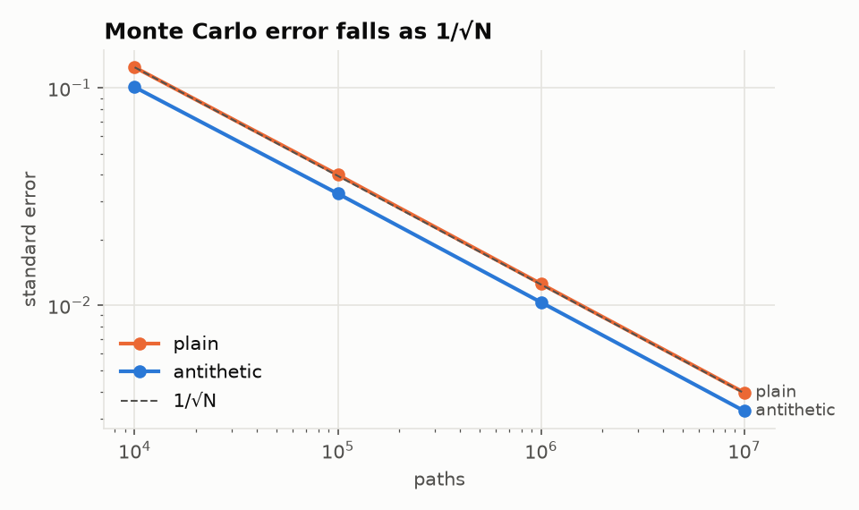
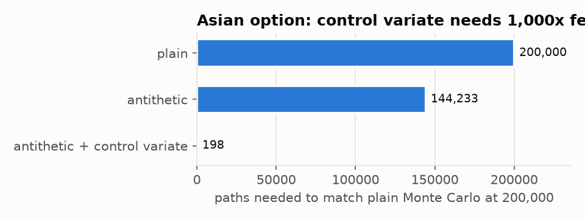
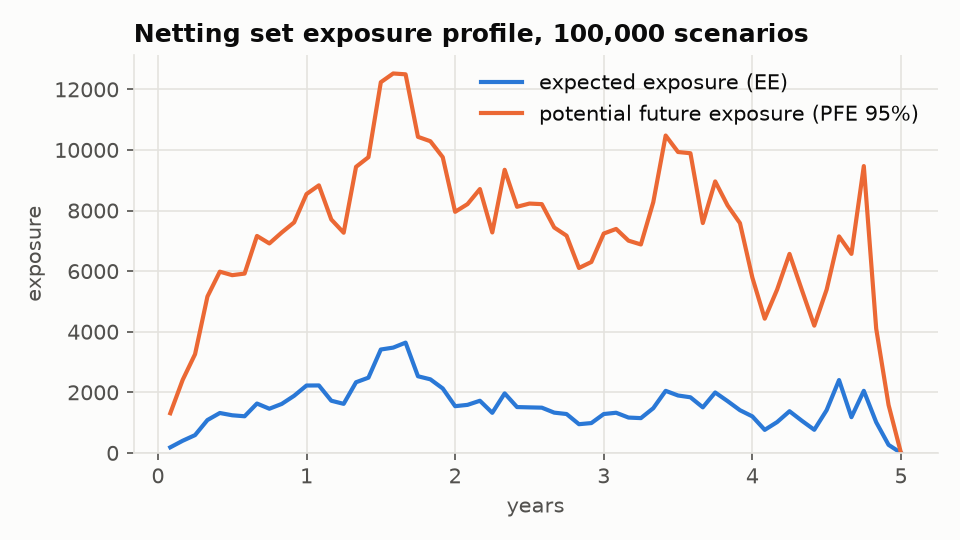

# Models and how they are validated

Deliberately standard, textbook models: the point of the project is the
platform around them. Each one is checked against an independent reference
in a named test.

## Products

| Product | Model | Method | Reference used to validate | Test |
| --- | --- | --- | --- | --- |
| European call/put | Black-Scholes-Merton (GBM, continuous dividend yield) | Closed form | Hull's textbook value (10.4506); put-call parity; finite-difference Greeks | `BlackScholes.*` |
| European call/put | GBM | Monte Carlo, antithetic, pathwise delta and vega | Closed form within 4 standard errors | `EuropeanMc.PriceAndPathwiseGreeksMatchBlackScholes` |
| Arithmetic Asian | GBM, n equally spaced fixings | Monte Carlo + geometric-Asian control variate | Plain MC agrees within combined error; one fixing reduces exactly to Black-Scholes | `AsianMc.*` |
| Geometric Asian | GBM | Closed form | Brute-force simulation written out in the test | `GeometricAsian.MatchesBruteForceSimulation` |
| Exposure (EE, PFE) | Correlated GBM, full revaluation per step | Monte Carlo | Long call: EE(t) = C(0)e^{rt} (martingale); forward: closed-form Black formula | `Exposure.*` |

## Monte Carlo

Under GBM the terminal price is

$$S_T = S_0 \exp\left(\left(r - q - \tfrac{1}{2}\sigma^2\right)T + \sigma\sqrt{T}\,Z\right)$$

and the price is the discounted mean payoff, with standard error
$\hat\sigma/\sqrt{N}$.

**Antithetic variates.** Each draw $Z$ is paired with $-Z$. The standard
error is computed over pair averages, because the two halves of a pair are
negatively correlated, not independent.

**Pathwise Greeks.** Delta $= e^{-rT} E[\mathbf 1_{ITM} S_T/S_0]$ and vega
$= e^{-rT} E[\mathbf 1_{ITM} S_T(\sqrt{T}Z - \sigma T)]$ (with the payoff's
sign), estimated from the same paths as the price. This is unbiased because
the payoff's kink has probability zero. For products without pathwise
Greeks, the service can bump and revalue (`simulation.greeks`): the
counter-based RNG reuses the same random numbers for each bump (common random
numbers), so the differences are smooth.

**Control variate (Asian).** The geometric average of lognormals is
lognormal, so the geometric Asian has a closed form. With $X$ the arithmetic
payoff and $Y$ the geometric one:

$$\hat\theta = \bar X - \beta(\bar Y - E[Y]),\qquad \beta = \frac{\mathrm{Cov}(X,Y)}{\mathrm{Var}(Y)},\qquad \mathrm{Var}(\hat\theta) = \frac{\mathrm{Var}(X)(1-\rho^2)}{n}$$

with $\log G \sim N\!\left(\log S_0 + (r-q-\tfrac{\sigma^2}{2})\tfrac{T(n+1)}{2n},\ \sigma^2 T\tfrac{(n+1)(2n+1)}{6n^2}\right)$.
The two payoffs are about 99.95% correlated, so the variance falls about
1,000×:

## Exposure, PFE and CVA

For a netting set of options and forwards on correlated underlyings
(Cholesky factor of the correlation matrix), each scenario evolves every
underlying on a monthly grid. At each step every live trade is revalued
(Black-Scholes for options, closed form for forwards), and the netting
set's exposure is $E(t) = \max(V(t), 0)$.

- **EE(t)**, expected exposure: the mean of $E(t)$ across scenarios.
- **PFE_q(t)**, potential future exposure: the $q$-quantile of $E(t)$.
- **EPE**: time-weighted average of EE over the horizon.
- **Unilateral CVA**, with a flat hazard rate from the credit-triangle
  approximation $\lambda = s/(1-R)$ and survival $Q(t) = e^{-\lambda t}$:

$$\mathrm{CVA} = (1-R)\sum_i DF(t_i)\,EE(t_i)\,\big[Q(t_{i-1}) - Q(t_i)\big]$$

**Simplifications, stated plainly:** no collateral or margin period of risk,
flat rate and hazard curves, Black-Scholes revaluation, constant volatility,
and no wrong-way risk. A production XVA engine handles all of these; the
point here is the distributed computation pattern (scenario blocks, exact
merge, reproducible across workers), not the model.
