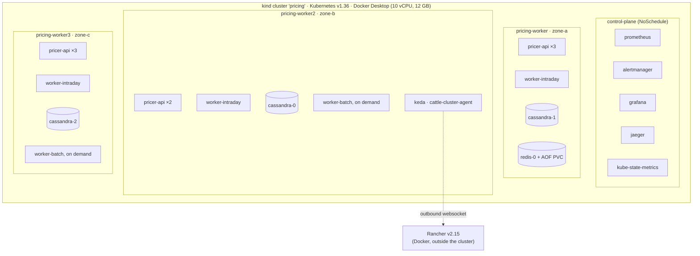
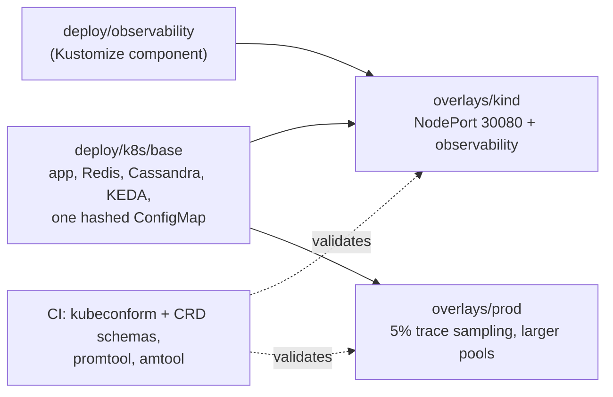
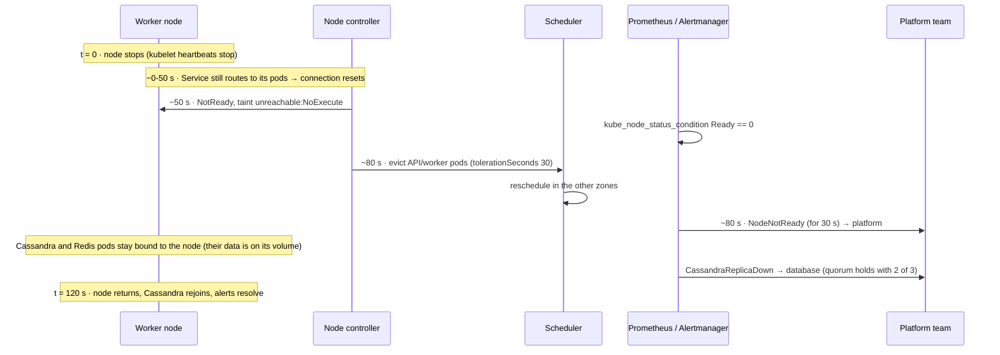
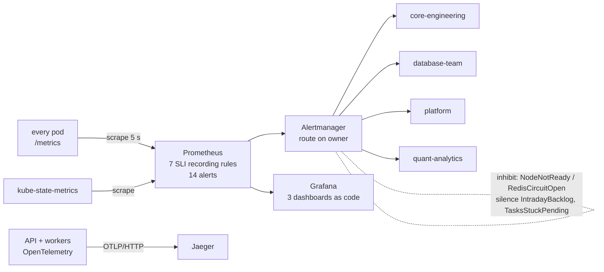
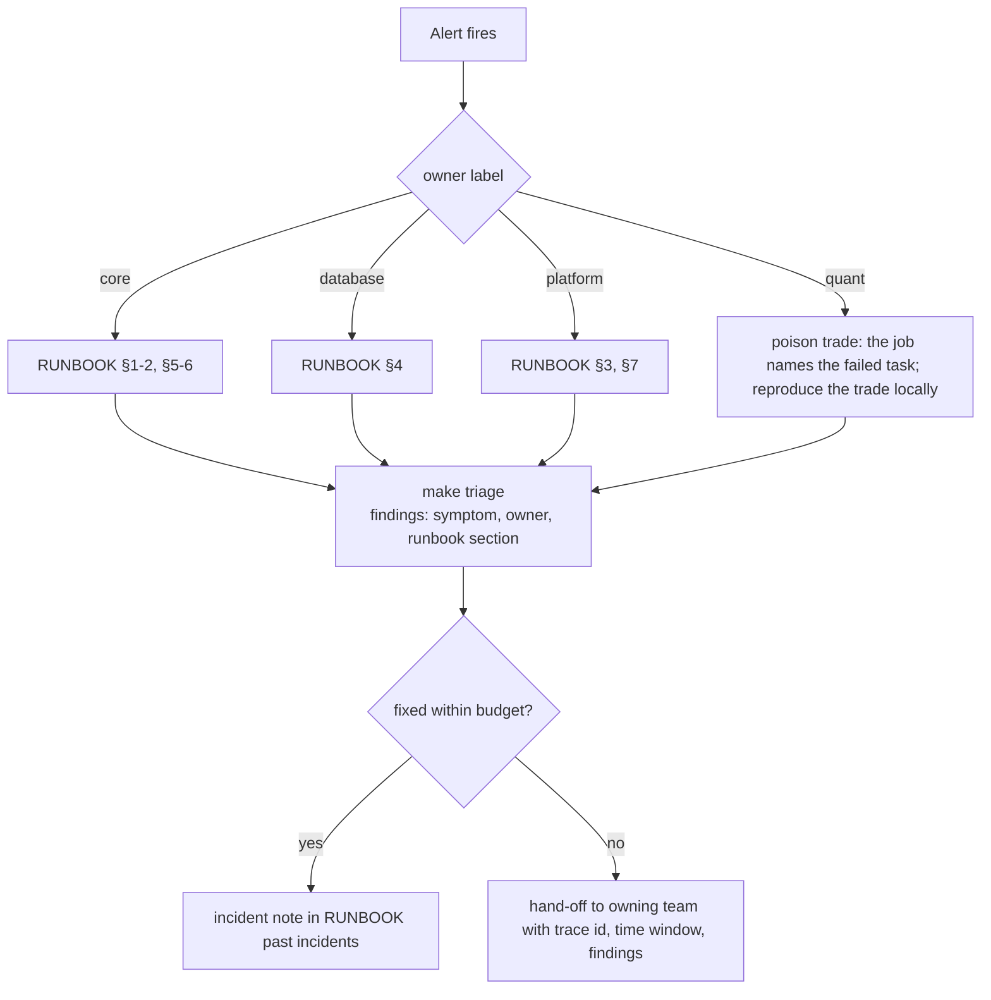

# Operations: Kubernetes, Rancher and SRE

How the service is deployed, managed, observed and kept within its SLOs.
[SYSTEM_DESIGN.md](SYSTEM_DESIGN.md) covers the request paths;
[SLO.md](SLO.md) and [RUNBOOK.md](../RUNBOOK.md) cover objectives and
incident response.

## Cluster topology

Pod placement is a snapshot from the running cluster, and it moves as pods
reschedule. What does not move is the set of placement rules:

| Workload | Kind | Placement and disruption rules |
| --- | --- | --- |
| `pricer-api` | Deployment, HPA 3-8 | Zone topology spread (maxSkew 1), PDB `minAvailable: 2`, rolling update `maxUnavailable: 0`, evicted 30 s after its node is unreachable |
| `pricer-worker-intraday` | Deployment, KEDA 2-8 on `pricing:intraday` lag | Zone spread, 30 s unreachable toleration, SIGTERM drains the current task |
| `pricer-worker-batch` | Deployment, KEDA 0-6 on `pricing:batch` lag | Same; idles at zero, cooldown 90 s |
| `cassandra` | StatefulSet ×3 | Required pod anti-affinity (one per node), PDB `maxUnavailable: 1`, `nodetool drain` on stop, RF 3 with `NetworkTopologyStrategy` |
| `redis` | StatefulSet ×1 | AOF on a PersistentVolume, `volatile-ttl` eviction so queues are never evicted |
| Observability | Deployments | Pinned to the control plane (toleration + node selector), so they outlive a worker node |

## Environments

The config lives in one generated ConfigMap with a content hash in its
name, so a config change rolls the pods instead of leaving them on stale
values.

## Rancher

Rancher runs as a Docker container on the same Docker network as kind,
and the cluster is imported through Rancher's API (`make rancher`, script
`scripts/rancher.sh`). The `cattle-cluster-agent` inside the cluster
dials out to Rancher, so the cluster needs no inbound access. That is the
same model used to manage clusters behind a firewall. From Rancher:

- **Cluster → Nodes** shows zone labels, taints and pressure; a lost node
  shows as Unavailable with the `unreachable` taints.
- **Workloads** shows the API, both worker pools (the batch pool at 0/0
  when idle) and the StatefulSets.
- **Events** is the first stop when a pod will not schedule (anti-affinity
  or a PDB blocking a drain).

The local Rancher password and API token stay in gitignored files and are
never committed.

Running Rancher on the same laptop as the cluster taught a lesson,
recorded in RUNBOOK incident 12: under chaos load Rancher crash-looped
from CPU starvation. The management plane belongs on its own cluster.

## Losing a node

The 0-50 s window is where the chaos runs lost books, and the reason
for the proposed resubmit-by-job-id change.

## Observability pipeline

### Alerts

| Alert | For | Severity | Owner |
| --- | --- | --- | --- |
| `PriceAvailabilityFastBurn` | 1 h and 5 m windows | page | core |
| `PriceAvailabilitySlowBurn` | 6 h and 30 m windows | ticket | core |
| `PriceLatencyBurn` | 1 h and 5 m windows | page | core |
| `IntradayBacklog` | 1 m | page | core |
| `TasksStuckPending` | 2 m | ticket | core |
| `AdmissionRejecting` | 2 m | ticket | core |
| `ApiReplicasUnavailable` | 30 s | page | core |
| `PodRestarting` | immediate | ticket | core |
| `RedisCircuitOpen` | 30 s | page | platform |
| `NodeNotReady` | 30 s | page | platform |
| `CassandraCircuitOpen` | 30 s | ticket | database |
| `CassandraReplicaDown` | 1 m | ticket | database |
| `PriceLogDropping` | immediate | ticket | database |
| `PoisonTrade` | immediate | ticket | quant |

Every alert links to a runbook section, and `make triage` names the same
owner. The alert rules, the runbook and the triage tool share one
ownership table, so they can't disagree.

### Dashboards

- **Pricing Service:** throughput by route and status, latency
  percentiles, cache hit rate, C++ compute time by product, worker tasks
  by outcome, queue depth per stream, circuit breaker state.
- **Pricing SLOs:** availability and latency against target, burn rate
  against the page and ticket thresholds, firing alerts by owner.
- **Pricing on Kubernetes:** ready replicas per workload (KEDA visible),
  node readiness, pods per node, restarts, queue lag that drives KEDA.

The dashboards are generated from Python (`deploy/observability/grafana/dashboards.py`)
and provisioned, never edited by hand in the UI.

### Tracing

The API starts a trace for each request. For books and exposure runs, the
W3C `traceparent` travels inside each Redis Stream message, so worker spans
join the same trace. Sampling is head-based at the API (100% on kind, 5% in
prod), and workers follow the parent's decision. Polling loops run inside a
suppression context so they don't bury the useful spans. Every response
carries `x-trace-id` for lookup in Jaeger.

## On-call flow

## Chaos testing

`make chaos` (`bench/chaos.py`) runs ten minutes of mixed load against a
fault schedule. It SIGKILLs API pods, workers of both pools, a Cassandra
node and Redis, and stops a whole node for 120 s. It records every
request, book and exposure run, then checks that exposure results are
bit-identical and lists which alerts fired and where they were routed.
The results and what each run found are in
[PERFORMANCE_REVIEW.md](PERFORMANCE_REVIEW.md), finding 11.
