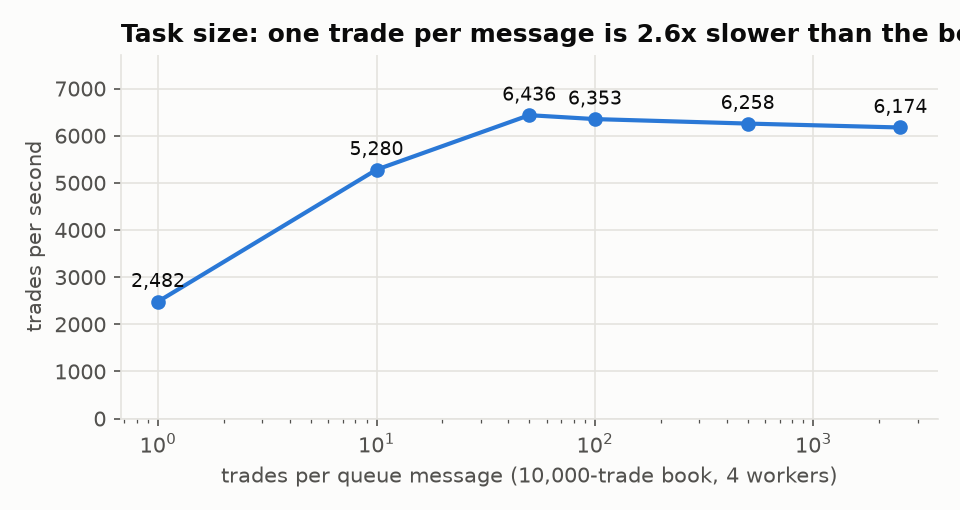

# Performance review

The JD for this kind of role asks to "review the system architecture and
propose improvements to enhance performance". This is that exercise, done
on this system. Each finding follows the same pattern: what I observed,
what I thought was going on, what I changed, what the measurement then
said, and what I decided. Three of my hypotheses turned out wrong; those are
written up too, because the measurement that disproved them is the useful
part.

**Setup.** Apple M4 (4 performance + 6 efficiency cores, 16 GB), macOS 26.5.
Compose and kind both run inside Docker Desktop's Linux VM (10 vCPUs; 8 GB
for the Compose runs, 12 GB for the kind cluster with Rancher), so
"workers" share one machine's cores: absolute numbers are for this
laptop, and the trends are the point. All numbers come from
`bench/results/*.json`, produced by the scripts in `bench/`.

---

## 1. Where book pricing stops scaling

**Observed.** A mixed 10,000-trade book (40% closed-form, 40% Monte Carlo
European, 20% Monte Carlo Asian, 20,000 paths) scales from 2,295 trades/s on 1
worker to 7,335 on 8. That is near-linear to 4 workers, then flattening.

**Hypothesis.** Either the architecture has a serial bottleneck (API, Redis,
the queue), or the machine is out of CPU.

**Test.** Price the same book with 1,000 paths per trade instead of 20,000.
Compute becomes negligible, so what is left is the pipeline: validation,
queueing, cache round trips, aggregation.

**Result.** The pipeline alone moves **43,000 trades/s**, about 6× the
compute-bound rate. The 8 workers × 2 C++ threads (16 threads) share 10
vCPUs, of which 6 sit on efficiency cores.

**Decision.** The architecture is not the limit; the machine is. On a real
cluster, workers get their own cores and the same design scales further.
Recorded as a capacity fact, not a code change.

## 2. A measurement mistake, and what the price log really costs

**Observed.** With `docker stats` sampling during a run, turning the price
log off appeared to give +30% throughput, and the workers appeared about a
quarter idle.

**Hypothesis.** Workers wait on synchronous Cassandra inserts after every
task.

**Re-measured** without anything else running, interleaving on/off runs,
best of 3 each:

| Price log | Run 1 | Run 2 |
| --- | --- | --- |
| on | 6,705 trades/s | 6,878 trades/s |
| off | 7,858 trades/s | 7,773 trades/s |

**Result.** The real cost is about 14%, not 30%: `docker stats` is itself
CPU-heavy and had skewed the first measurement. The remaining cost is CPU,
not waiting: the Cassandra driver (Cython-compiled, checked) serializing
rows, plus Cassandra itself on the same cores.

**Decision.** Accept 14% for an audit trail on a shared laptop. On a cluster
Cassandra runs on its own nodes. Lesson: measure first, profile
separately.

## 3. Write-behind for the price log

**Observed.** A cache-miss `/price` took 3.68 ms at p50, while the C++
pricing itself takes about 1 ms.

**Hypothesis.** The request waits for its Cassandra insert.

**Change.** A bounded write-behind queue (`store.WriteBehind`): the request
enqueues the row and returns; a background thread writes. If the queue fills
(Cassandra slow or down), rows are dropped and counted, never blocking
pricing.

| `/price` cache miss | p50 | p99 | Book throughput (8 workers, 10k) |
| --- | --- | --- | --- |
| synchronous log | 3.68 ms | 5.49 ms | 7,669 trades/s |
| write-behind | **1.03 ms** | **1.65 ms** | 8,208 trades/s |

**Result.** 3.6× lower single-price latency. Book throughput did not change
meaningfully; per finding 2, that cost is CPU, which write-behind does not
remove.

**Decision.** Keep. Trade-off: rows still queued when a pod is SIGKILLed
are lost. That is acceptable because every logged price is reproducible from
its request hash.

**Follow-up: the dashboard caught a bug in it.** Under mixed load (about 700
`/price` per second plus books), Grafana's "log rows dropped/s" climbed to
about 200/s. Every `/price` miss enqueues a one-row batch, and the drain
thread wrote one batch per round trip (about 2 ms each), which caps the log
near 500 rows/s. The drain now coalesces everything already queued (up to
2,000 rows) into one concurrent write. Under the same load: **0 rows
dropped** (`test_write_behind_coalesces_small_batches`).

## 4. Batch risk was blocking intraday pricing

**Observed.** With one FIFO task stream, a 1,000-trade intraday book queued
behind a 200,000-scenario exposure run.

**Change.** Two streams: intraday (books) and batch (exposure). Workers
always read intraday first, and block on both only when both are empty.
Exposure blocks are sized so a worker is never busy with batch work for
long.

| Queue | Intraday book, idle | Same book during a batch run | Batch run |
| --- | --- | --- | --- |
| one FIFO stream | 0.22 s | **5.17 s** | 6.00 s |
| intraday ahead of batch | 0.30 s | **0.32 s** | 6.59 s |

**Result.** During a batch run the intraday book now takes 0.32 s instead of
5.17 s, about what it takes on an idle system. The batch run pays a little
for that, 6.59 s instead of 6.00 s, because it yields to intraday work between
blocks. That is the right trade for a trading desk.

**Decision.** Keep. The remaining delay is bounded by one exposure block's
runtime, which is what `block_size` tunes.

## 5. Task granularity

**Observed.** One message per trade is the obvious first design.

**Result.** Per-message overhead (a stream entry, a result write, an ack,
Python parsing) dominates at 1 trade per message: 2,482 trades/s against
6,436 at the best size. Past about 50 to 100 trades the curve is flat,
and very large tasks start to lose a little to stragglers: a few big tasks
cannot be spread evenly across workers.

**Decision.** Default `task_size` = 100, exposed per request.

## 6. Kernel CPU throttling, and a fix that did not move latency

**Observed.** `cpu.stat` on the API pods: one pod throttled in 627 of 3,950
CFS periods (16%), 24 s throttled in total.

**Hypothesis.** 4 compute slots × 2 C++ threads = 8 threads against a
2-CPU limit, so the quota runs out mid-period and the kernel stalls the
whole pod. This is a classic source of tail latency.

**Change.** Size concurrency to the limit: the API runs 1 thread × 2 slots
(it serves many small requests); workers keep 2 threads.

| Same load (16 clients, 200k paths, 60 s) | Throttled periods | Throughput | p50 | p99 |
| --- | --- | --- | --- | --- |
| 4 slots × 2 threads | 113 / 1,812 (6%) | 1,946 req/s | 6.9 ms | 27.9 ms |
| 2 slots × 1 thread | 3 / 4,836 (0.06%) | 1,883 req/s | 6.9 ms | 32.4 ms |

**Result.** Throttling eliminated; latency unchanged within noise. On a
single-node cluster every pod competes for the same host cores, so host
contention, not the quota, sets the tail. Requests now wait at the
admission semaphore instead of in the kernel.

**Decision.** Keep, because it is the correct sizing and matters on dedicated
nodes. But I record that it did not pay off here, rather than claiming a
win.

**Correction found later: what workload was that?** The load generator
picked strikes from only 4,000 values, so over a 60 s run most "unique"
requests collided and were cache hits. The table above therefore measured a
cache-heavy mix. After fixing the generator, about 80% of requests are cache
misses. Under that compute-bound mix the same pods sit at their 2-CPU limit
and are throttled in 34 to 78% of periods, whatever the thread sizing,
because Python request handling runs on top of the C++ threads. Replaying
the old mix against the same deployment gives 1,612 req/s; the corrected mix
gives about 800. No code regressed; the workload changed. Under a
compute-bound load, throttling is the quota doing its job, and the remedy is
more pods (the HPA), not thread tuning. The lesson: always state the
workload a number came from.

## 7. Releasing the GIL, and batch interfaces

C++ that holds the GIL serializes every Python thread calling it. Releasing it
(arguments converted first, no Python objects touched inside) gives:

| Python threads | GIL released | GIL held |
| --- | --- | --- |
| 1 | 45.8 pricings/s | 44.2 |
| 2 | 90.8 | 44.2 |
| 4 | 145.9 | 45.7 |
| 8 | 175.5 | 46.0 |

For closed-form pricing, call overhead dominates the arithmetic, so the
interface matters more than the language:

| 1M Black-Scholes prices | Options/s |
| --- | --- |
| pure Python loop | 0.85M |
| one C++ call per option | 3.3M |
| `bs_batch`, NumPy in and out, 1 thread | 26.9M |
| `bs_batch`, 8 threads | **146.8M** |

The worker prices every closed-form trade in a task with one `bs_batch` call.

## 8. Variance reduction: performance through maths

For the arithmetic Asian, the geometric-average control variate cuts the
variance **1,009×**: 198 paths with the control match the error of 200,000
plain paths. That is three orders of magnitude of compute that no amount of
hardware buys as cheaply.

## 9. Circuit breakers (measured when introduced)

Measured on the build that introduced them (the RUNBOOK incidents give the
details):

| Outage under load | Without breaker | With breaker |
| --- | --- | --- |
| Redis, worst second | 22 req/s, p99 859 ms | 923 req/s, p99 60 ms |
| Cassandra, whole run | 846 req/s, p99 114 ms | 1,033 req/s, p99 40 ms |

## 10. Exposure runs: scaling and exactness

200 trades on 5 correlated underlyings, 60 monthly steps, 100,000 scenarios
(604 million live option revaluations):

| Workers | Time | Revaluations/s | Identical PFE and CVA |
| --- | --- | --- | --- |
| 1 | 7.98 s | 76M | yes |
| 2 | 4.50 s | 134M | yes |
| 4 | 2.87 s | 210M | yes |
| 8 | 2.69 s | 225M | yes |

The determinism (counter-based RNG plus the exact top-k merge) means
scaling out changes the runtime and nothing else.

---

## 11. Chaos runs: what broke, and what the fixes bought

Ten minutes of mixed load (continuous single prices, a 2,000-trade book every
15 s, an exposure run every 150 s) on the kind cluster while
`bench/chaos.py` injects 11 faults: SIGKILLs of API pods, intraday and batch
workers, a Cassandra node and Redis, and one whole Kubernetes node stopped
for 120 s.

| Run | Single prices served | Books complete | Trades failed in completed books | Exposure runs | Alerts that fired |
| --- | --- | --- | --- | --- | --- |
| 1 | 99.999% (1 error in 150,101) | 35 of 38 | 0 of 70,000 | 4 of 4, identical | CassandraReplicaDown, PodRestarting |
| 3 | 99.992% (6 errors in 76,481) | 29 of 30 (3 retried) | 0 of 58,000 | 4 of 4, identical | + NodeNotReady, RedisCircuitOpen |

Run 2 is excluded: screenshots and Rancher crash-looping on the same CPUs
contaminated it (99.61%), though every book still completed.

**What run 1 found.** The 3 lost books all died at the connection level
in the ~50 s between the node stopping and Kubernetes marking it NotReady,
while the Service still sent traffic to pods on it. No trade was mispriced;
the HTTP call simply never got an answer. Books are idempotent (same
request, same hash, same prices), so the client now retries once. In run 3
that saved 3 books. **One book still failed both attempts**, both times a
connection reset while the node was down. A blind HTTP retry is the wrong
tool for a two-minute outage; the fix is an idempotency key the client
can poll on (next step 2).

**What run 2 found.** NodeNotReady never fired, because kube-state-metrics
was scheduled on the node that was stopped: the monitoring died with the
thing it watched. The observability stack is now pinned to the control
plane. In run 3 NodeNotReady fired and was routed to the platform team.

## 12. KEDA scale-from-zero: what idle batch capacity costs

The batch pool scales on its stream's lag (`lagCount` 4, polling every 5 s)
and idles at zero. The same exposure run, from cold and from warm
(`bench/bench_keda.py`):

| Start | First worker ready | Run time | Peak replicas |
| --- | --- | --- | --- |
| 0 replicas (cold) | 10.3 s | 38.1 s | 6 |
| 6 replicas (warm) | 0.5 s | 9.4 s | 6 |

The cold run pays about 10 s to schedule and start the first pod, then
grows 1 → 4 → 6 as lag stays high. For overnight batch, 29 s of latency
for zero idle cost is a good trade. For an intraday CVA desk it would not
be, which is why the intraday pool keeps a floor of 2 and scales on lag
above it.

## 13. What tracing costs

The same 45 s `/price` load with every request traced (`OTEL_SAMPLE_RATIO=1.0`)
and none (`0.0`), on the kind cluster (`bench/bench_tracing.py`):

| Sampling | Prices/s |
| --- | --- |
| 0% | 312 |
| 100% | 278 |

About 11% of throughput, which is mostly span creation and export on CPUs
the pricer also needs. The prod overlay samples 5% at the API, and workers
follow the API's decision (parent-based sampling), so a sampled book is
traced end to end and an unsampled one costs nothing. One traced
2,000-trade book is 206 spans across 3 pods: per task one span each for the
queue message, the Redis `MGET`, the analytic batch, the Monte Carlo batch
and the result pipeline. An earlier version had a span per trade, which
buried the useful ones.

## 14. Where the monitoring runs

This is the same failure as run 2, written up as an architecture finding,
because it generalises. Anything that alerts on a failure domain must not
live inside it. On kind the fix is a node selector and toleration for the
control plane. In production the equivalent is a separate monitoring
cluster, or at least Prometheus and Alertmanager spread across zones, plus
a dead man's switch alert that pages when the alert pipeline itself goes
quiet.

A smaller one found while capturing the report: the availability SLI was
`5xx rate / total rate`, which is *empty*, not zero, when there are no 5xx
responses at all, so the SLO panel showed "No data" exactly when the
service was healthiest. The recording rules now use `(... or vector(0))`.

---

## Proposed next steps

Ranked by expected value per effort:

1. **Move the price log off the worker CPUs.** Workers append results to a
   Redis stream, and a small log-shipper writes Cassandra. That recovers
   finding 2's 14%.
2. **Book submission with an idempotency key.** The client chooses the job
   id; on a connection failure it polls `/jobs/{id}` instead of re-sending
   the book, so a book survives an outage longer than one retry. That
   closes the one book lost in finding 11.
3. **Blocking completion instead of polling** ([code audit](CODE_AUDIT.md), finding 7) once
   concurrent books reach the hundreds.
4. **A dead man's switch** for the alert pipeline (finding 14).
5. **GPU path for exposure revaluation.** The work per scenario is
   independent and arithmetic-dense, the shape GPUs suit; the exact block
   merge already makes adding a different kind of worker transparent.
