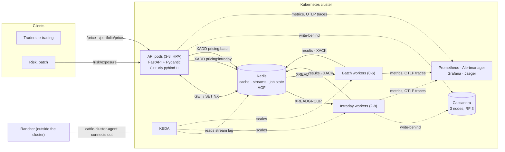
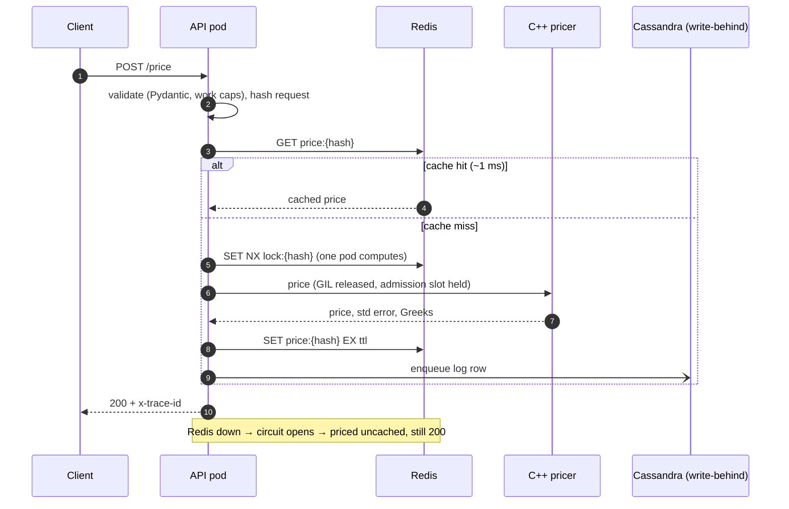
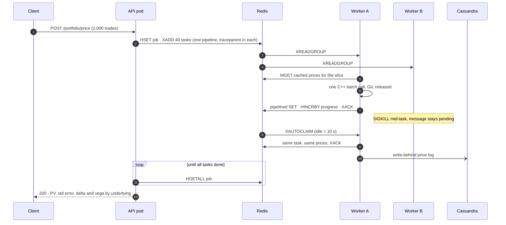
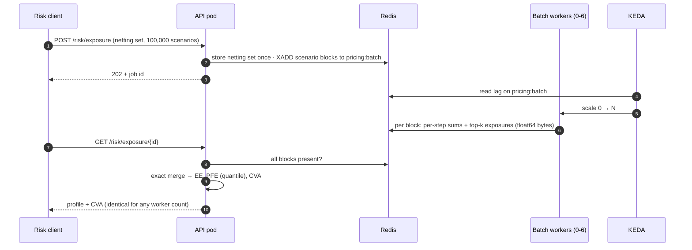
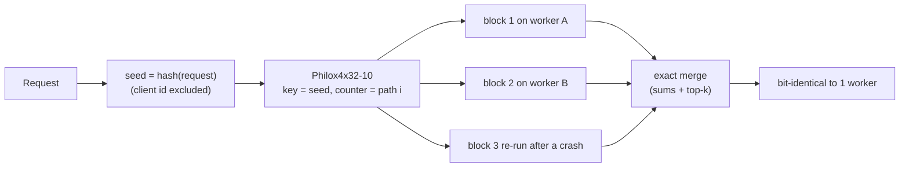
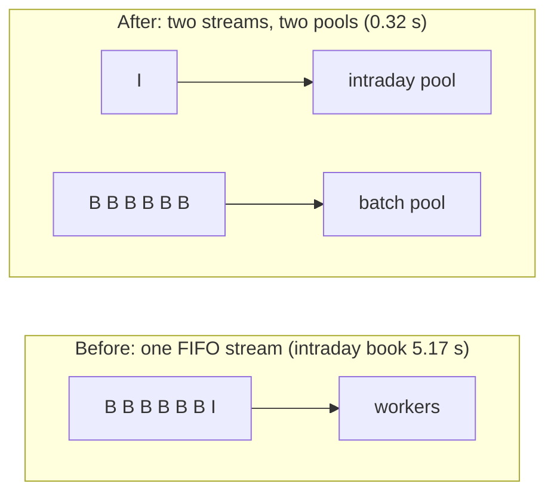

# System design

The design in diagrams: what talks to what, how each request type moves
through the system, and the decisions behind it, along with what each one
costs. [ARCHITECTURE.md](ARCHITECTURE.md) has the component-level detail, and
[OPERATIONS.md](OPERATIONS.md) has the Kubernetes, Rancher and SRE view.

## Context

## Single price: synchronous, latency matters

## Book: distributed, intraday priority, survives a dead worker

A task delivered three times without success is marked failed in its job
and acked, and the `PoisonTrade` alert goes to the quant team. One bad
trade can't wedge the queue; the book still returns, with `n_failed`
counting the trades that could not be priced.

## Exposure run: batch, asynchronous, exact merge

## Why the answers are reproducible

A counter-based generator gives path *i* the same random numbers on any
thread, worker or node. Caching is therefore safe, sharding is exact, and
re-running a task after a crash is harmless. The chaos run relies on this
to check its own exposure results.

## Priority: before and after

## Decisions and their costs

| Decision | Instead of | Why | Cost accepted |
| --- | --- | --- | --- |
| Redis Streams + consumer groups | Redis list; Kafka | Per-message ack, reclaim (`XAUTOCLAIM`), lag readable by KEDA, one system fewer | Single Redis instance; the AOF survives restarts, not losing its node |
| Separate intraday and batch streams | One FIFO | Risk runs can't delay a trader's book (5.17 s → 0.32 s) | Two pools to size; cold start for batch |
| Results written before ack | Ack on receipt | At-least-once with idempotent re-runs | A task may be priced twice after a crash |
| Cassandra, write-behind | Postgres; synchronous writes | Append-heavy, time-bucketed, query-first, TTL, RF 3 | Log lags by up to ~1 s; a crash can drop the unwritten tail (metered and alerted) |
| KEDA on stream lag | HPA on CPU | Lag leads; CPU trails a queue | Another controller to run |
| Admission control sized to CPU limit | Unbounded concurrency | Fast 503 + `Retry-After` beats a slow timeout | Callers must retry |
| Observability on the control plane | Anywhere | Monitoring must not die with the node it watches | Needs infra nodes on a real cluster |
| Counter-based RNG keyed by request hash | Seeded per process | Reproducibility, safe caching, exact sharding | Request hashing must exclude non-economic fields |

## Capacity limits (by design)

- **Request work caps** in the Pydantic models: `n_paths × steps` is
  bounded, so a runaway request gets a 422, not an OOM-killed pod.
- **Admission:** a semaphore sized to the pod's CPU limit (`COMPUTE_SLOTS`).
  Beyond it, 503 with `Retry-After`, and the `AdmissionRejecting` alert
  goes to core engineering.
- **Write-behind queue:** bounded at 10,000 batches and coalesced into
  writes of up to 2,000 rows. Overflow drops the row (never the price),
  and `PriceLogDropping` goes to the database team.
